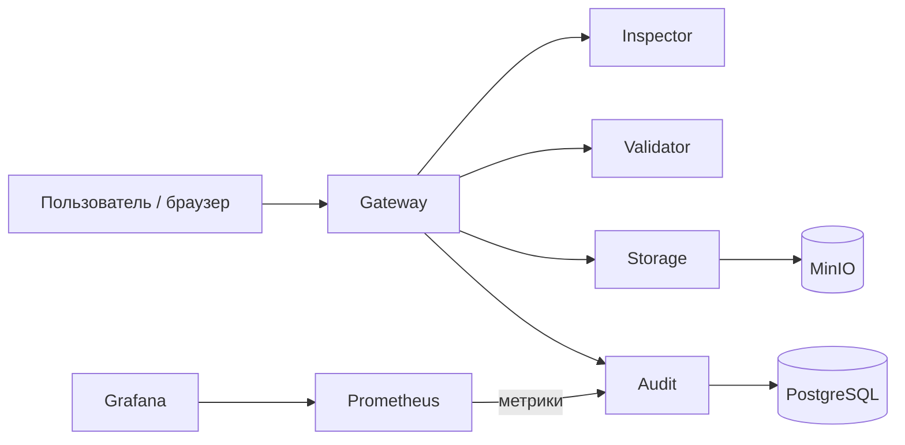

# Format Security Pattern

Исследовательский прототип для изучения контроля формата входящих файлов в микросервисной архитектуре. Стенд сопоставляет заявленные метаданные и определённый формат JSON, XML или CSV, проверяет структуру, маршрутизирует объект и фиксирует событие аудита. Проект предназначен для демонстрации инженерных решений и не является промышленным средством защиты информации.

## Постановка задачи

Расширение и MIME-тип файла не гарантируют соответствие содержимому. Прототип показывает, как выявить противоречие, отделить подозрительные объекты и наблюдать результаты обработки. Корректный объект получает `ACCEPT` и сохраняется в `trusted`; несоответствие формата или метаданных приводит к `QUARANTINE` и сохранению в `quarantine`. При отсутствии такого несоответствия неопределённый формат или ошибка структуры приводят к `REJECT` без сохранения объекта. Несоответствие метаданных имеет приоритет; карантинные объекты не проходят структурную проверку.

## Архитектура



Пять прикладных сервисов:

- **Gateway** — API и веб-интерфейс, оркестрация проверки и выбор решения.
- **Inspector** — определение фактического формата и сравнение с заявленным.
- **Validator** — структурная проверка JSON, XML и CSV; для XML используется `defusedxml`.
- **Storage** — сохранение объектов и работа с карантином в MinIO.
- **Audit** — запись событий в PostgreSQL и публикация метрик Prometheus.

Стек: Python 3.12, FastAPI, Uvicorn, HTTPX, SQLAlchemy, PostgreSQL, MinIO, Prometheus, Grafana, Docker Compose и Kubernetes. Сервисы взаимодействуют по HTTP; Kubernetes — альтернативный вариант запуска, описанный в [k8s/README.md](k8s/README.md).

## Локальное развёртывание

Нужны Docker Engine и Docker Compose; для PowerShell-скриптов — Windows и команда `docker-compose`. Локальный Python для стенда не требуется. Из корня проекта:

```powershell
Copy-Item .env.example .env
# Отредактируйте .env: задайте локальные учётные данные
docker compose up --build -d
docker compose ps
```

На Windows также доступен `./start.ps1`: он создаёт `.env` из примера, если файл отсутствует, и проверяет готовность доступных интерфейсов. Образец содержит только демонстрационные значения; замените их перед запуском. `.env` не включается в Git. Учётные данные PostgreSQL в URL Compose подставляются напрямую: для пароля используйте символы, не требующие URL-кодирования. Смена паролей в `.env` не меняет уже инициализированные учётные данные в постоянных томах PostgreSQL и Grafana.

| Интерфейс | Локальный адрес |
| --- | --- |
| Веб-интерфейс и API Gateway | http://localhost:8080 |
| Grafana | http://localhost:3000 |
| Prometheus | http://localhost:9090 |
| MinIO Console | http://localhost:9001 |

Эти порты привязаны к `127.0.0.1`. Внутренние сервисы, PostgreSQL и S3 API MinIO доступны другим контейнерам в сети Compose, но их порты не опубликованы на хосте. Страница `/test-objects` содержит демонстрационные сценарии. Пример запроса:

```powershell
curl.exe -F "file=@services/validator/tests/samples/valid.json;type=application/json" http://localhost:8080/ingest
```

Остановка без удаления данных: `docker compose down` или `./stop.ps1`. Скрипт `./reset.ps1` запрашивает подтверждение и удаляет тома с данными; `-Force` отключает запрос. Это необратимый сброс локального стенда.

## Тестирование

Для каждого сервиса создайте отдельное окружение Python 3.12 и установите зависимости разработки, например:

```powershell
cd services/gateway
python -m venv .venv
.\.venv\Scripts\Activate.ps1
python -m pip install -r requirements-dev.txt
python -m pytest
```

Повторите для `inspector`, `validator`, `storage` и `audit`. GitHub Actions запускает тесты всех пяти сервисов в отдельных заданиях при push и pull request. Тесты не заменяют проверку полного развёртывания с внешними зависимостями.

Последний аудит (15 ноября 2026 года): **98 автоматизированных тестов**, **10 сквозных сценариев** в Docker Compose и **25 валидных ресурсов Kubernetes** при проверке схем. Работающий Kubernetes-кластер был недоступен, поэтому развёртывание и E2E в кластере в рамках этого аудита не проверялись.

## Мониторинг

Prometheus собирает метрики Audit; Grafana автоматически получает datasource и dashboard из `infra/grafana`. Метрики включают решения `accepted_objects_total`, `quarantined_objects_total`, `rejected_objects_total`, ошибки проверки и распределение времени обработки. В Prometheus запрос `up{job="audit"}` показывает доступность цели сбора. Для Grafana используйте реквизиты из `.env`; в Kubernetes мониторинг и хранение метрик описаны отдельно в инструкции к манифестам.

## Ограничения безопасности

- Аутентификация и авторизация пользователей и межсервисных запросов не реализованы; локальная привязка портов не защищает от других локальных пользователей и процессов.
- TLS отсутствует. Общая Docker-сеть не изолирует сервисы друг от друга; Kubernetes Service типа ClusterIP сам по себе не обеспечивает сетевую сегментацию. NetworkPolicy не настроены.
- Демонстрационные учётные данные и Kubernetes Secret из примера предназначены только для изолированного стенда; Kubernetes Secret не является полноценным хранилищем секретов. MinIO использует общую привилегированную учётную запись.
- Имена файлов и события сохраняются в аудите, сами объекты — в MinIO; не используйте реальные персональные или конфиденциальные данные. Политики хранения и удаления не реализованы.
- При недоступности Audit основной процесс может продолжиться без успешной записи события. Это поведение сохранено; журнал не гарантирует полноту.
- Проверка формата и структуры не является антивирусной проверкой, анализом содержимого или гарантией безопасности файла. Ограничение размера файла по умолчанию — 10 МиБ; оно проверяется после разбора multipart и не ограничивает весь HTTP-запрос или предварительное временное сохранение загрузки. Rate limiting и общие квоты ресурсов не реализованы.

- Для устранения известных предупреждений `pip-audit` закреплены совместимые FastAPI `0.133.0`, Starlette `1.3.1` и python-multipart `0.0.31`. Остальные транзитивные зависимости не зафиксированы полностью; результат аудита зависит от даты и разрешённых версий. Полный отчёт проверки и ограничения приведены в [AUDIT_REPORT.md](AUDIT_REPORT.md).
